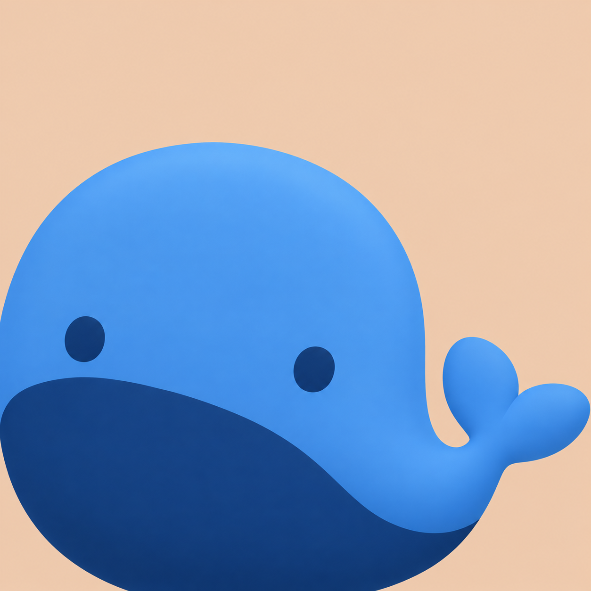
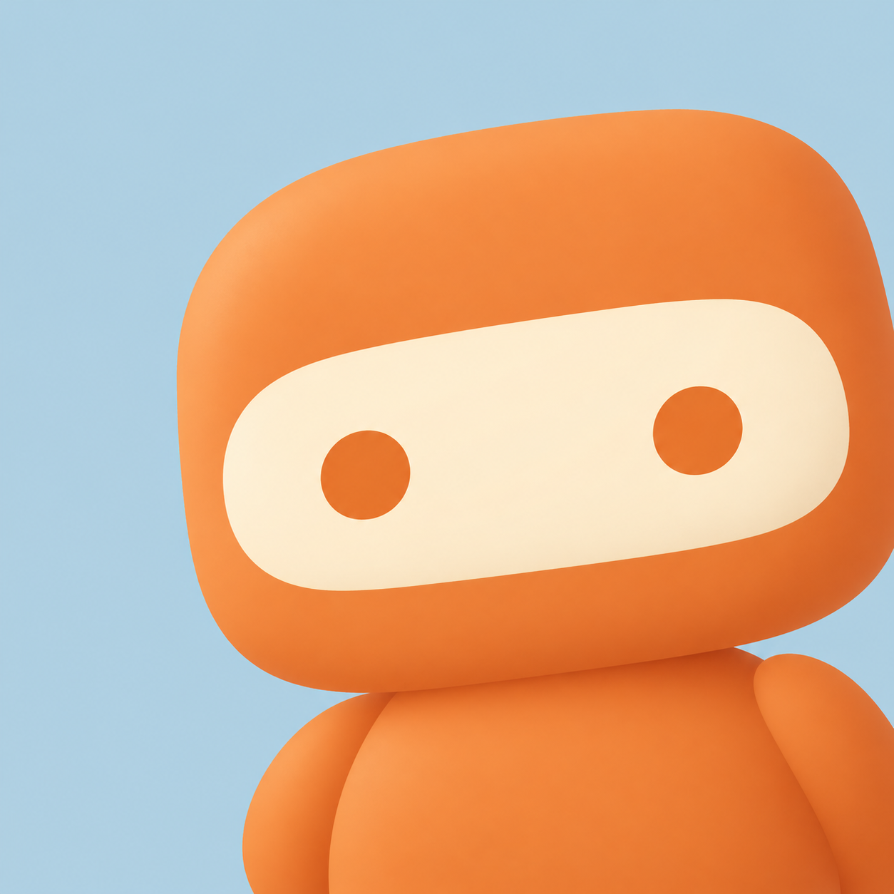

# ByteTrace 应用图标候选

本批包含六张独立生成的原始候选图。未替换正式图标，未调整图片尺寸或裁剪。

六张均为原生 1254 × 1254 PNG，已读取图片元数据确认尺寸。

设计参考：[IP as Logo](https://github.com/s1dashu/ip-as-logo-skill/blob/main/SKILL.md)。

生成方式：OpenAI 内置 image_gen 工具。工具未公开具体模型标识。限制条件写入主提示词（main-prompt constraints），每张独立调用一次，不引用其他候选图。

## 方向与配色

| 编号 | 方向与产品联系 | 构图 | 主体色 | 辅助色 | 背景色 | 文件 |
| --- | --- | --- | --- | --- | --- | --- |
| A1 | 小鲸鱼：网络流量与持续传输 | 左下 | #3E8DDD | #163B68 | #EBCDB6 | [A1-whale-lower-left.png](A1-whale-lower-left.png) |
| A2 | 小鲸鱼：网络流量与持续传输 | 右下 | #356CC4 | #B6E2DC | #EBCDB6 | [A2-whale-lower-right.png](A2-whale-lower-right.png) |
| B1 | 猫头鹰：持续观察各应用用量 | 左下 | #36356E | #D9CDEB | #B9CFB0 | [B1-owl-lower-left.png](B1-owl-lower-left.png) |
| B2 | 猫头鹰：持续观察各应用用量 | 右下 | #8188DB | #30316C | #B9CFB0 | [B2-owl-lower-right.png](B2-owl-lower-right.png) |
| C1 | 小机器人：字节计量与应用归属 | 左下 | #EF8A38 | #753831 | #BAD4E3 | [C1-robot-lower-left.png](C1-robot-lower-left.png) |
| C2 | 小机器人：字节计量与应用归属 | 右下 | #E87E38 | #FFF0D2 | #BAD4E3 | [C2-robot-lower-right.png](C2-robot-lower-right.png) |

以上为提示词指定的色彩，实际生成结果原样保留。

每张图的完整提示词、约束、颜色映射及输出路径见 [prompts.json](prompts.json)。

## 预览

| 左下构图 | 右下构图 |
| --- | --- |
| A1 小鲸鱼  | A2 小鲸鱼  |
| B1 猫头鹰  | B2 猫头鹰  |
| C1 小机器人  | C2 小机器人  |
